# LivWay Operations: painel de pedidos para uma trading de importação

> Sistema interno, em produção e em uso diário, que centraliza pedidos, follow-ups, parceiros, embarques e relatórios de uma trading de importação. Projetado, desenvolvido, publicado e mantido por mim, do zero, de ponta a ponta.

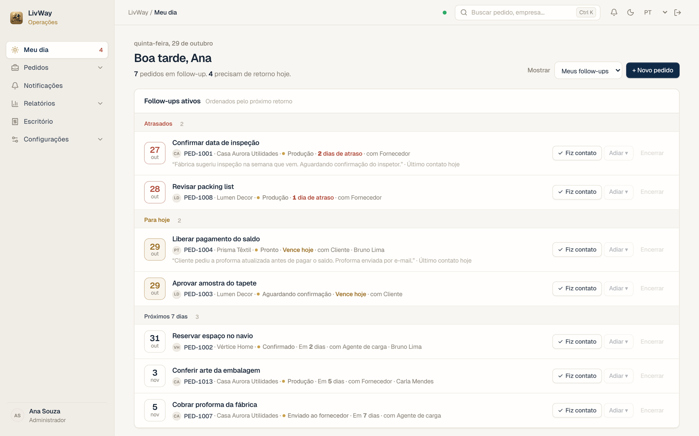

> Todas as imagens deste README foram feitas numa cópia local do sistema com **dados fictícios** (empresas, pedidos, pessoas e e-mails inventados). Nenhum dado real da empresa aparece aqui.

---

## Em resumo

| | |
|---|---|
| **O quê** | Painel web e app instalável para acompanhar pedidos de importação, do pedido à entrega |
| **Para quem** | Equipe interna da trading e parceiros externos (agentes e fábricas), cada um com o seu nível de acesso |
| **Meu papel** | Tudo: levantamento com a operação, telas, banco de dados, back-end, front-end, segurança, publicação e manutenção |
| **Stack** | Next.js 16, React 19, TypeScript, Tailwind CSS 4, Cloudflare Workers, D1 (SQLite) e R2 |
| **Tamanho** | 28 rotas de API, 17 migrações de banco, teste de fluxo ponta a ponta com mais de 40 cenários |
| **Ritmo** | Da v7 à v10.1, com mais de 10 publicações em produção só em outubro de 2026, sem perda de dados |

## O problema

A operação acompanhava dezenas de pedidos de importação ao mesmo tempo em planilhas, e-mails e mensagens soltas. Isso trazia quatro dores:

- **Ninguém sabia o que precisava de atenção hoje.** Pedidos parados passavam dias sem contato.
- **Parceiros externos precisavam ver parte dos pedidos**, mas sem enxergar dados internos como cliente, fornecedor e margem.
- **As atualizações dos agentes de carga chegavam só por e-mail**, misturadas na caixa de entrada.
- **O relatório mensal de embarques era montado à mão** a partir de várias fontes.

## A solução

Um painel web único, instalável no celular, onde cada pedido concentra dados, etapas, conversa, arquivos, embarque e histórico, com permissões finas para cada tipo de usuário e uma tela inicial que diz o que fazer hoje.

---

## Funcionalidades

### 1. Meu dia e follow-up ativo

A tela inicial mostra os pedidos que precisam de retorno, separados em **Atrasados**, **Para hoje** e **Próximos 7 dias**. Cada linha diz o motivo, com quem está a pendência (cliente, fornecedor, agente de carga) e o último contato.

- Colocar um pedido **em follow-up** com motivo, data do próximo retorno e uma ou várias pessoas responsáveis.
- Botões **Fiz contato**, **Adiar** e **Encerrar** direto da lista; cada ação vira uma linha no histórico do pedido e avisa as outras pessoas do follow-up.
- O follow-up encerra sozinho quando o pedido é finalizado ou cancelado.

| Modo claro | Modo escuro |
|---|---|
|  | 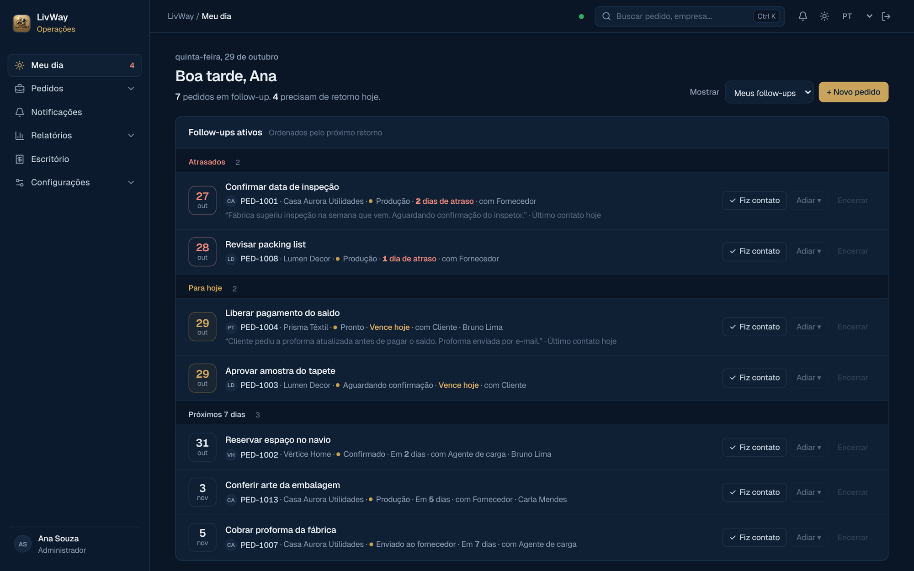 |

### 2. Pedidos

Lista com visões rápidas (**Em aberto**, **Em follow-up**, **Atrasados**), ordenação por prioridade, filtros recolhidos, totais em dólar e indicação de pedidos sem valor (vazio não conta como zero). Pedidos finalizados ficam escondidos por padrão e aparecem no fim com um botão.

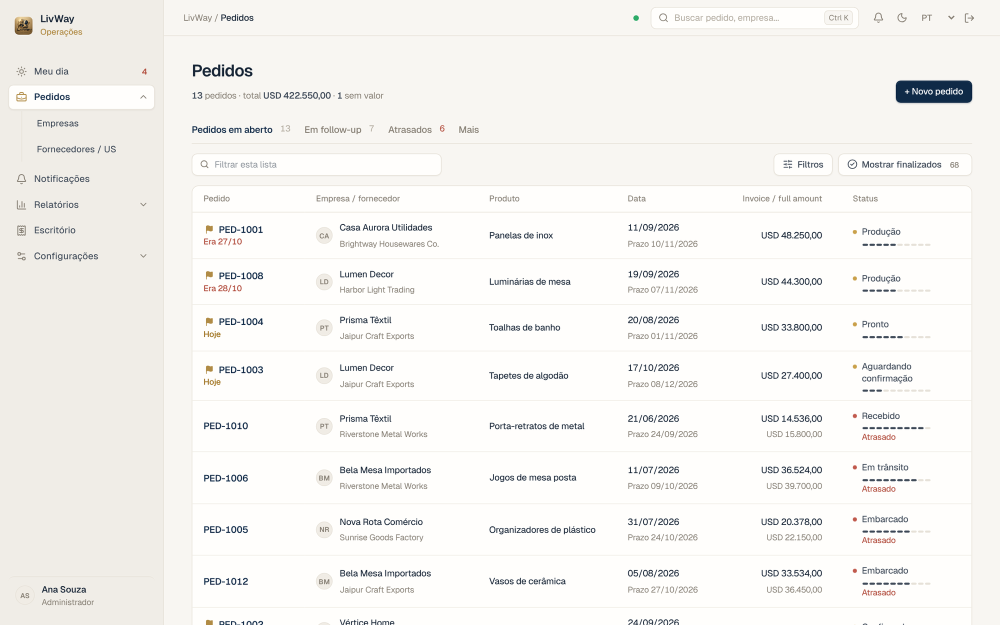

A busca filtra a lista enquanto se digita, avisa quando há resultados fora da visão atual e não se perde ao abrir um pedido e voltar. No topo, a lupa ou **Ctrl+K** levam direto à busca.

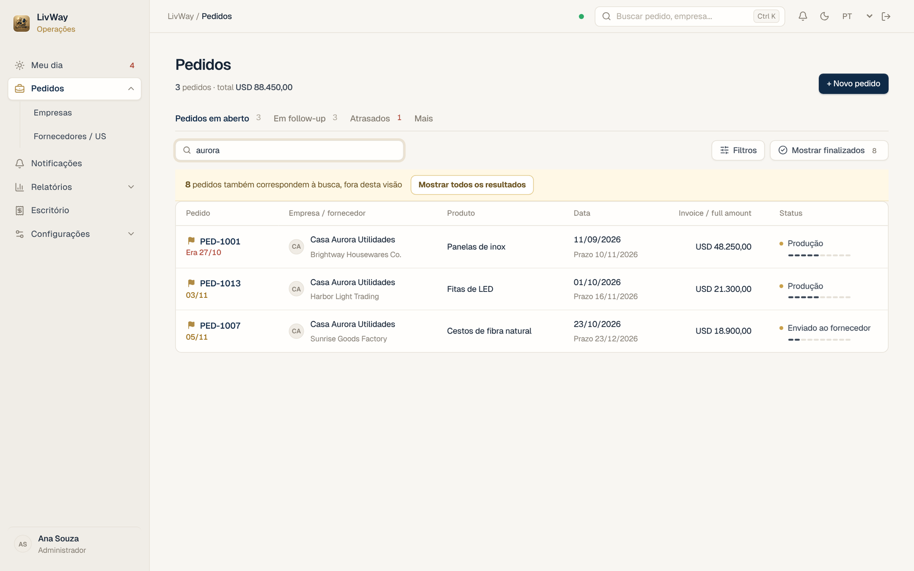

### 3. Página do pedido

Linha do tempo das etapas (configuráveis), botão **Avançar etapa**, prazo, invoice, quadro de follow-up e abas para conversa, arquivos e histórico interno, com navegação Anterior/Próximo entre pedidos.

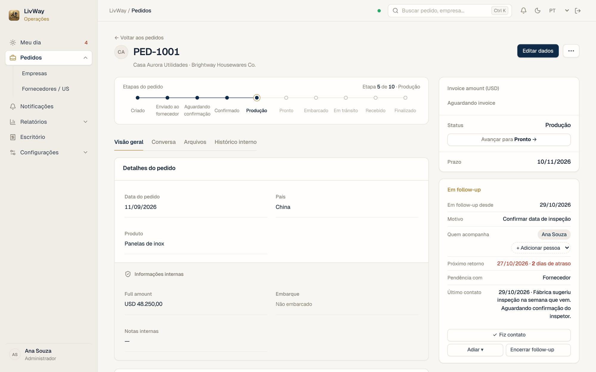

**Conversa com parceiros**: cada mensagem tem destinatários. Parceiros escrevem só para a equipe interna e nunca veem a conversa de outros parceiros. Os anexos também são privados por destinatário.

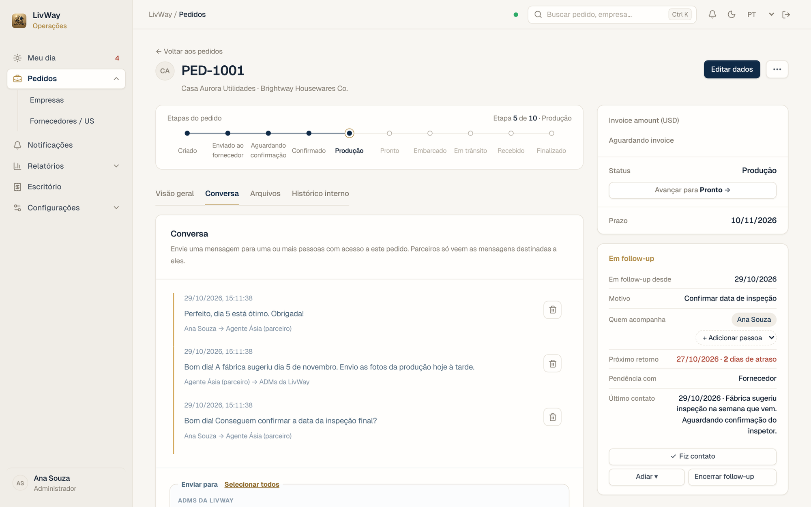

### 4. Follow-up dos agentes de carga, lido do e-mail

Os agentes de carga mandam as atualizações de embarque por e-mail. O Gmail da empresa encaminha esses e-mails para um endereço do sistema (Cloudflare Email Routing), e o próprio Worker:

1. guarda o e-mail e os anexos no R2;
2. reconhece o número do pedido no assunto ou no corpo (mesmo escrito com espaços, como "PED - 1005");
3. lê a tabela do agente (origem, destino, transbordo, ETD, ETA, container, free time) e a linha do tempo de atualizações;
4. mostra tudo num **quadro Embarque** dentro do pedido e numa página com todos os embarques, ordenados pela próxima chegada.

| Quadro Embarque no pedido | Todos os embarques |
|---|---|
| 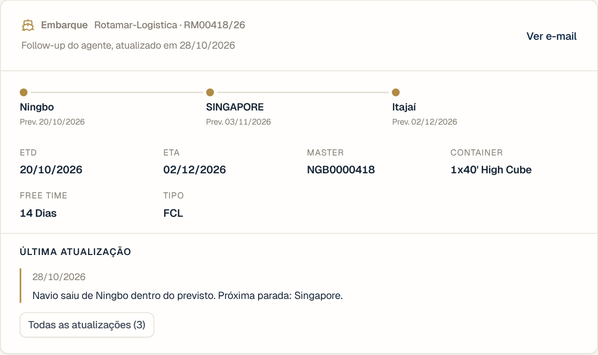 | 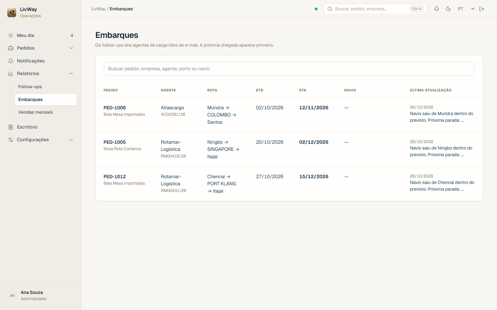 |

Todo e-mail recebido fica na **Caixa de follow-up**, com os anexos e os pedidos que ele cita, inclusive os que não puderam ser lidos automaticamente.

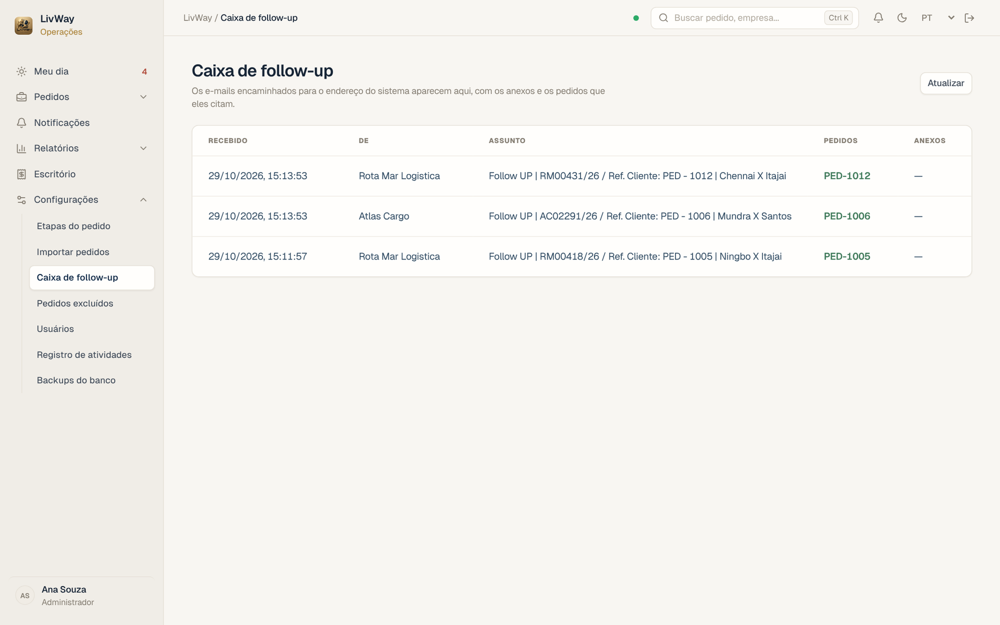

### 5. Relatórios e vendas mensais

- **Vendas mensais**: pedidos pelo mês do embarque, com Full amount, Invoice amount, margem bruta, comparação com o ano anterior e filtros por país e empresa.
- **Relatório mensal de embarques**: importa e gera a planilha Excel no layout exato usado pela empresa, com **lançamento rápido** linha a linha (pedido e empresa novos são criados sozinhos).
- **Relatório de follow-up**: o que avançou, o que está parado, prazos vencidos e pedidos sem contato no período, com exportação para Excel e PDF.

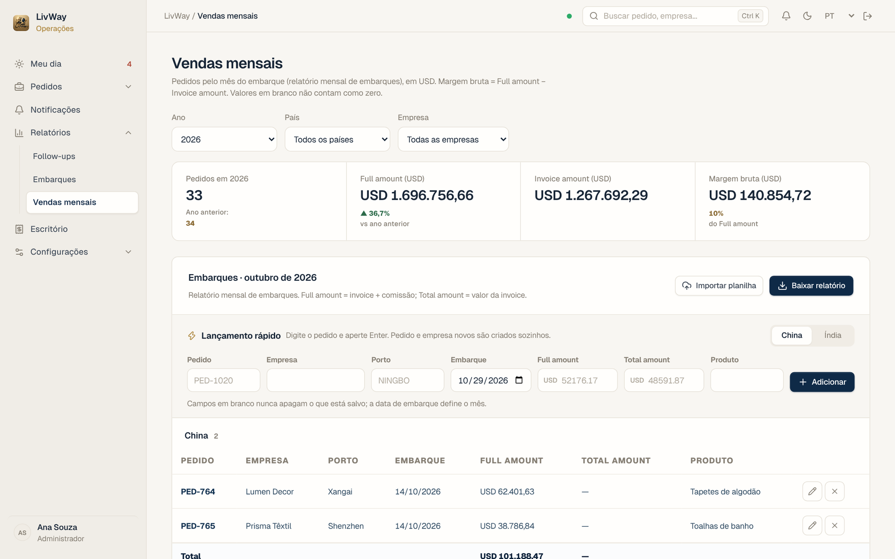

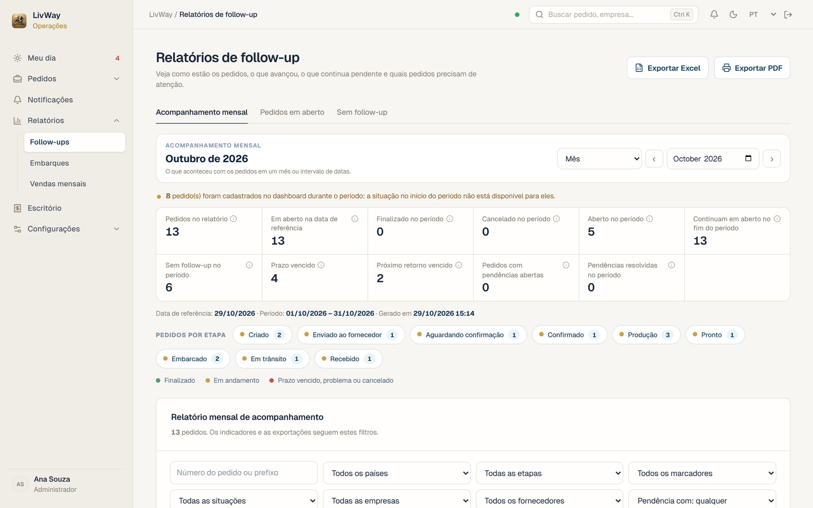

### 6. Importação e cadastros

- Importação de pedidos por Excel ou CSV, com mapeamento de colunas, prévia, distinção entre célula vazia e inválida e gravação em lotes com barra de progresso. Reimportar o mesmo arquivo não duplica nada.
- Cadastro de empresas e fornecedores com detecção e junção de **duplicadas** (nomes iguais ou parecidos, ignorando acentos e maiúsculas).

### 7. App no celular, avisos e modo escuro

- **PWA** instalável no iPhone e no Android, com ícone próprio e página offline.
- **Avisos no celular (Web Push)** para mudanças em pedidos e mensagens, implementados com chaves VAPID e sem serviço de terceiros.
- **Modo claro e escuro**, lembrado também por cookie (funciona até em navegadores que bloqueiam o armazenamento local).
- Layout pensado para celular e computador; interface em português e inglês.

| Meu dia no celular | Pedidos no celular (escuro) | Pedido no celular |
|---|---|---|
| 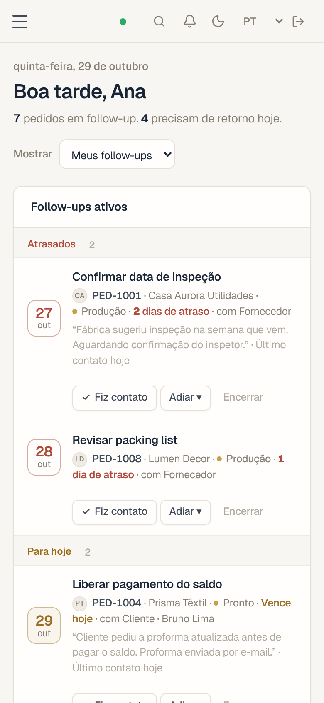 | 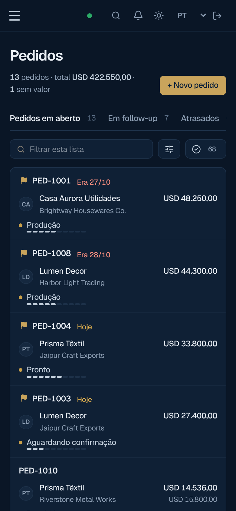 | 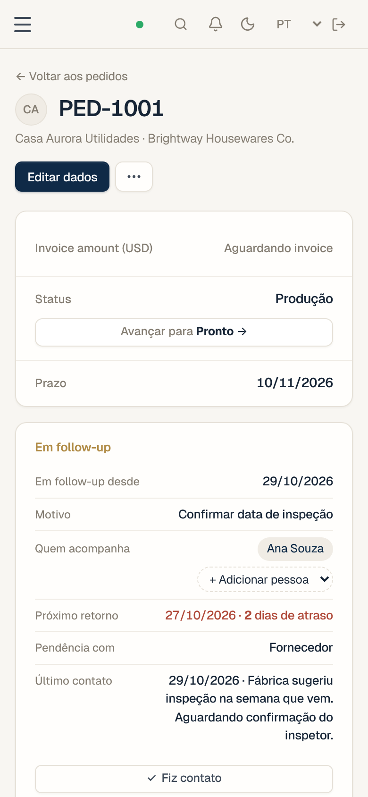 |

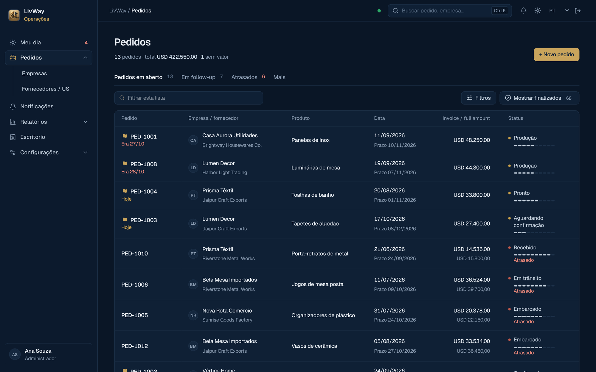

### 8. Administração, segurança e backups

- Contas novas esperam aprovação do administrador. Permissões por país, prefixo do pedido e ação (ver detalhes, editar, mudar etapa, notas, invoice, arquivos, excluir).
- Auditoria, registro de atividades e presença da equipe.
- Exclusões recuperáveis (pedidos, mensagens, arquivos), com tela para restaurar.
- **Backup diário automático** do banco às 03:00 no R2, guardado por 30 dias, com tela para fazer um backup na hora e baixar qualquer cópia.
- **Cópia fora da Cloudflare**: uma rotina diária no GitHub Actions exporta o banco, compacta com senha (7-Zip) e guarda por 90 dias, para o caso de a nuvem principal ficar indisponível.

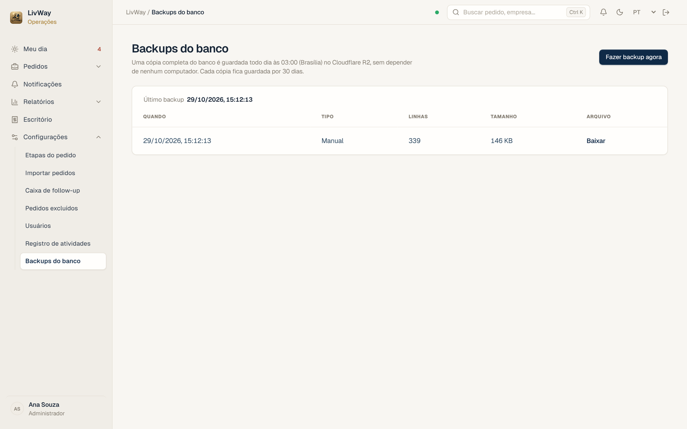

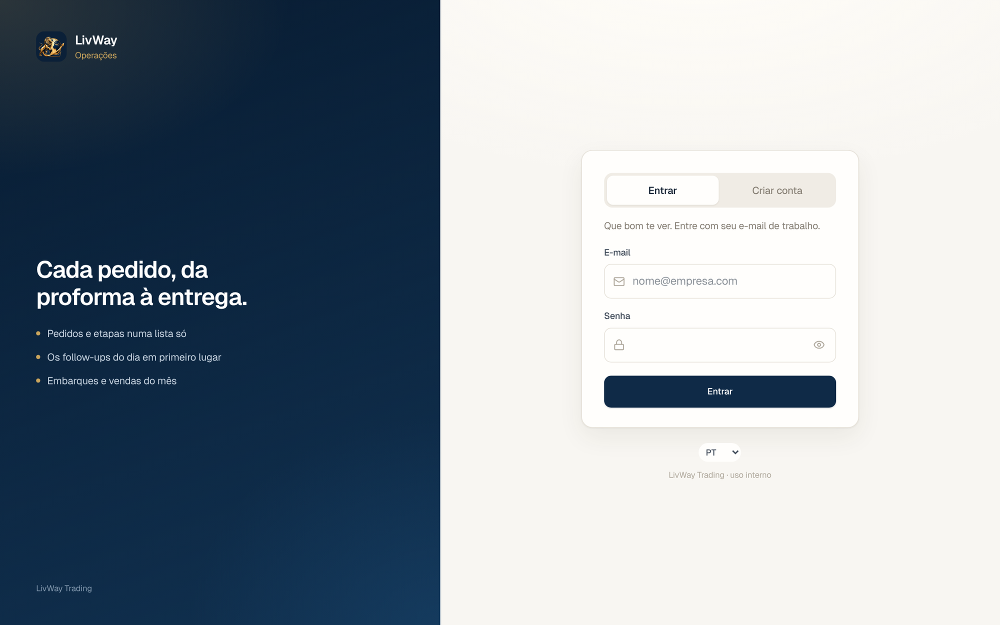

---

## Arquitetura

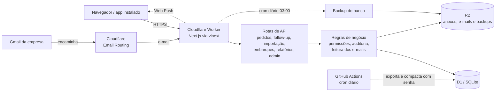

Um único **Cloudflare Worker** atende três tipos de entrada:

| Entrada | O que faz |
|---|---|
| `fetch` | Páginas (Next.js App Router) e a API REST em `app/api/*` |
| `scheduled` | Backup diário do banco para o R2 |
| `email` | Recebe os e-mails encaminhados dos agentes de carga, guarda no R2 e atualiza o embarque do pedido |

- **Camadas**: telas em `app/`, API em `app/api/*` e regras de negócio isoladas em `lib/` (autenticação, permissões, pedidos, notificações, auditoria, importação, relatórios, leitura de e-mails, backups).
- **Dados**: Cloudflare **D1** (SQLite na borda) com SQL direto e migrações versionadas; arquivos, e-mails brutos e backups no **R2**.
- **Sem servidor para manter**: tudo roda na borda da Cloudflare, com custo praticamente zero no volume atual.

## Tecnologias

| Camada | Escolha |
|---|---|
| Front-end | Next.js 16 (App Router), React 19, Tailwind CSS 4, componentes shadcn/ui, Recharts |
| Execução | Cloudflare Workers, com Next.js rodando sobre Vite pelo vinext |
| Banco de dados | Cloudflare D1 (SQLite), SQL direto com migrações versionadas |
| Arquivos | Cloudflare R2 (anexos, e-mails e backups) |
| E-mail | Cloudflare Email Routing e postal-mime para ler os e-mails |
| Planilhas | ExcelJS (leitura e geração de .xlsx) |
| Validação | zod |
| Notificações | Web Push com chaves VAPID, sem serviço de terceiros |
| Automação | GitHub Actions (cópia diária do banco fora da Cloudflare) |
| Linguagem | TypeScript |

## Decisões técnicas que valem destaque

- **Autenticação própria**: senha com PBKDF2-SHA256 (100 mil iterações), sessão em cookie httpOnly com apenas o hash do token no banco, limite de tentativas de login, checagem de origem em requisições que alteram dados e aprovação manual de contas novas.
- **Confidencialidade por desenho**: o acesso do parceiro exige país **e** prefixo do pedido ao mesmo tempo, e os dados internos são retirados no servidor, nunca só escondidos na tela.
- **Concorrência otimista**: cada pedido tem um número de revisão; se outra pessoa salvou antes, o sistema avisa em vez de sobrescrever.
- **Migrações só aditivas**: nenhuma coluna ou tabela é apagada, o que permite voltar a versão do código sem perder dados.
- **Vazio não é zero**: um pedido pode ser criado só com o número; campos não preenchidos ficam marcados como tal e não entram nas somas como zero.
- **E-mail guardado antes de ser interpretado**: o e-mail bruto vai para o R2 antes de qualquer leitura; se o formato de um agente mudar, nada se perde.
- **Importação resiliente**: gravação em lotes pequenos para respeitar o limite de consultas por requisição do D1, sem sobrescrever pedidos existentes.
- **Tema escuro gerado**: o CSS do modo escuro é gerado automaticamente a partir do tema claro por um script, para que telas novas já nasçam com os dois temas.
- **Teste de fluxo ponta a ponta**: um teste percorre as rotas da API contra um SQLite em memória (login, permissões, pedidos, conversa, importação, exclusões, follow-up, e-mails dos agentes), sem tocar no banco real.

## Processo de entrega

- Versões incrementais (da v7 à v10.1), cada uma com guia de atualização: o que mudou, como aplicar, como verificar e como reverter.
- Propostas visuais em imagens aprovadas pelos usuários antes de mexer nas telas.
- Antes de cada publicação: checagem de tipos, teste de fluxo, build e backup do banco; migração aplicada uma única vez, antes do deploy.
- Teste local com banco separado antes de publicar e reversão rápida pelo histórico de versões do Worker.

## Meu papel

Fiz o projeto sozinho: levantamento com a operação, desenho das telas, modelagem do banco, back-end, front-end, segurança, publicação e manutenção. Também conduzi as decisões de produto com os usuários (o que entra em cada versão e como cada tela deve funcionar no dia a dia).

## Sobre o código

O código-fonte pertence à empresa e fica em repositório privado. Este repositório reúne apenas a apresentação do projeto. Posso mostrar o sistema funcionando e detalhar partes do código em uma conversa.
